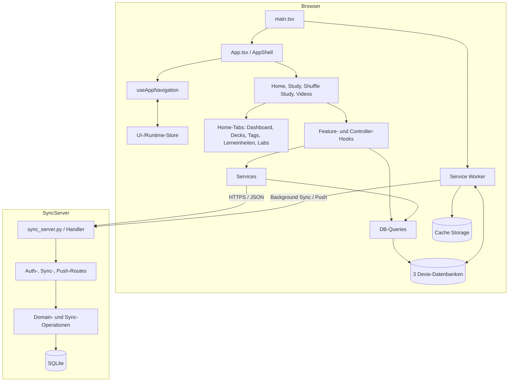
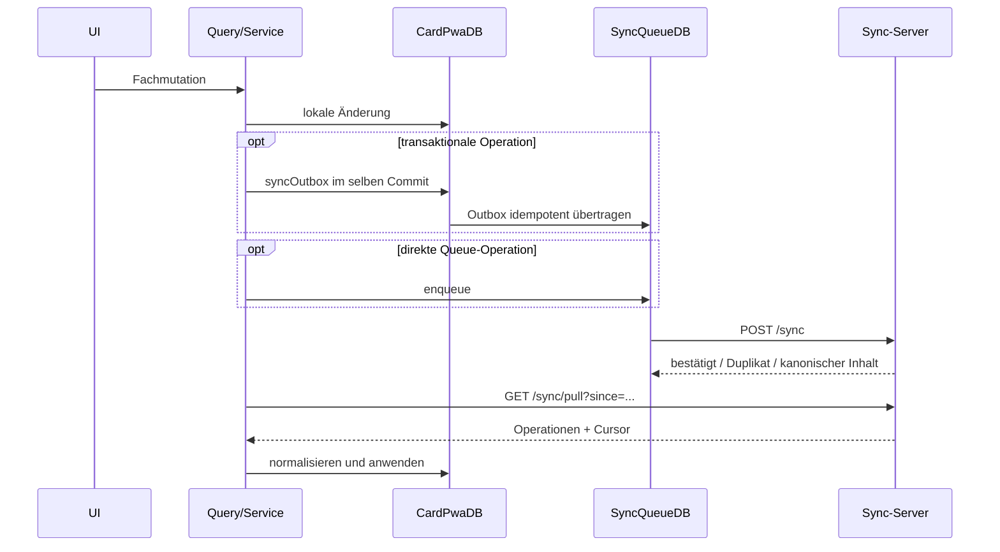

# Card_PWA — Technisches Architektur-Dossier

**Gegenstand:** Frontend `card_pwa/` und seine Schnittstelle zum Sync-Server `card-sync-server/`

**Stand:** 2026-09-24

**Methodik:** Statische Analyse des aktuellen Arbeitsbaums; Kennzahlen aus dem Dateisystem, Verträge aus Quellcode und Konfiguration. Keine Laufzeit- oder Performance-Messung.

> Dieses Dokument beschreibt den Ist-Zustand. Symbolnamen und stabile Dateipfade werden bewusst gegenüber Zeilennummern bevorzugt, weil Zeilenbereiche schnell veralten.

## 1. Ergebnis des Abgleichs

Das frühere Dossier vom 2026-07-27 war in mehreren Kernpunkten nicht mehr aktuell. Die wichtigsten Korrekturen sind:

| Bereich | Veralteter Stand | Aktueller Stand |
|---|---|---|
| Frontend-Stack | React 18, TypeScript 5.5, Vite 5, Dexie 4.0, Framer Motion 11 | React 19.3, TypeScript 7.0, Vite 8.3, Dexie 4.4, Framer Motion 13.2 |
| Navigation | sieben Vollbild-Views | fünf Navigationszustände; `learning-units` und `labs` sind Home-Tabs |
| State Management | kein zentraler Store | kleiner UI-/Runtime-Store auf `useSyncExternalStore` mit drei Slices |
| Modal-Basis | `ModalShell` mit vier Nutzern | `ModalShell` entfernt; neue Primitives `Dialog`, `AlertDialog`, `Sheet`, `FullscreenPanel` |
| Overlay-Verhalten | kein gemeinsamer Escape-/Fokus-/Stack-Vertrag | `useCloseGuard`, Overlay-Stack und `useOverlayFocusAndEscape` für migrierte Primitives |
| Backend | weitgehend monolithischer Sync-Server | `sync_server.py` als Composition Root plus Module für Routes, Auth, DB, Domain, Push und Sync |
| HTTP-Schnittstelle | 18 Endpunkte | 20 explizite GET-/POST-Endpunkte, zusätzlich `OPTIONS *` |
| Hauptdatenbank | Schema v19 | Schema v22 mit `syncOutbox` und erweiterten Review-/Scheduler-Daten |
| Lerneinheiten | zehn Stores | weiterhin zehn Stores, jetzt Schema v2 inklusive `labAttempts` |
| Tests | 112 Testdateien | 124 `*.test.ts(x)`-Dateien; 127 TS/TSX-Dateien im Testbereich einschließlich Hilfsdateien |

## 2. Kennzahlen

Die Zählung umfasst `.ts` und `.tsx` unter `card_pwa/src/`.

| Kennzahl | Wert |
|---|---:|
| TS/TSX-Dateien gesamt | 434 |
| Produktivdateien außerhalb von `__tests__` | 307 |
| Dateien im Testbereich `__tests__` | 127 |
| davon eigentliche `*.test.ts(x)`-Dateien | 124 |
| Produktivcode | 87.000 LOC |
| Testbereich einschließlich Fixtures/Helfer | 19.416 LOC |
| `src/components/` | 86 Dateien / 23.237 LOC |
| `src/hooks/` | 55 Dateien / 5.761 LOC |
| `src/services/` | 28 Dateien / 6.702 LOC |
| `src/db/` | 17 Dateien / 4.749 LOC |
| `src/utils/` | 81 Dateien / 10.322 LOC |
| `src/data/` | 12 Dateien / 31.663 LOC |
| React-Contexts | 2 (`ThemeContext`, `SettingsContext`) |
| externe Laufzeit-Abhängigkeiten | 14 |
| Service Worker | 1.559 LOC |
| globale Styles `src/index.css` | 1.805 LOC |
| IndexedDB-Datenbanken | 3 |
| aktive IndexedDB-Stores | 25 |
| explizite HTTP-Endpunkte des Sync-Servers | 20 |

Der große Anteil von `src/data/` ist beabsichtigt: statische SY0-701-Inhalte, Fragen, Labs und Zuordnungen liegen im Repository. Allein `sy0701Requirements.ts` umfasst 12.907 Zeilen.

## 3. Systemübersicht

Card_PWA ist eine Offline-first-Lernanwendung für Karten, Spaced Repetition, gemischte Lern-Sessions, Security+-Lerneinheiten, Labs und lokal bereitgestellte Professor-Messer-Videos. Persistente Lerndaten liegen primär in IndexedDB. Ein eigener HTTP-Server synchronisiert Profile, Karten, Reviews, Decks, Sammlungen, Video-Notizen und den Lernplan.



### Schichtgrenzen

Der beabsichtigte Hauptfluss lautet:

```text
App/Views → Komponenten → Hooks/Controller → Services oder db/queries → Dexie
                                              ↓
                                         Sync-Server
```

`card_pwa/scripts/check-architecture-imports.mjs` schützt zentrale Grenzen:

- UI-Komponenten sollen nicht direkt auf `db/index` zugreifen; zwei explizite Ausnahmen bleiben für Initialisierung und Full Reset.
- `db/queries` darf keine UI-Schicht importieren.
- `utils` darf grundsätzlich weder Komponenten noch Hooks oder Services importieren; drei dokumentierte Alt-Ausnahmen sind zugelassen.
- Direkte Dexie-Tabellenzugriffe außerhalb von `db/` benötigen eine explizite Ausnahme, insbesondere für Sync-, Import-, Backup- und Migrationsgrenzen.

**Prüfstatus am 2026-09-24:** `npm run check:architecture` schlägt aktuell für `src/services/dbBackup.ts` und `src/services/importPipeline.ts` fehl. Beide Dateien greifen als technische Batch-Grenzen direkt auf Dexie zu; die Ausnahme-Baseline nennt noch ihre früheren Pfade unter `src/utils/`. Damit sind entweder die Baseline-Pfade nachzuziehen oder die Zugriffe hinter eine freigegebene Datenzugriffsschicht zu verschieben.

## 4. Bootstrap, Shell und Navigation

### Einstieg

`src/main.tsx` führt vor dem React-Mount die Branding-Migration aus, initialisiert die Service-Worker-Registrierung und rendert die App unter `React.StrictMode`.

`src/App.tsx` stellt bereit:

- `LazyMotion` mit asynchron geladenen Motion-Features,
- `ThemeProvider` und `SettingsProvider`,
- `AppErrorBoundary` und `AppInitializer`,
- Startup-Splash, Update-Banner, Toasts und Safe-Area-Behandlung,
- Lazy Loading der primären Views.

### Navigationsmodell

Es gibt keinen Router. `useAppNavigation()` verwaltet den View-Wechsel und nutzt für den kanonischen View-State den UI-Store.

Der Typ `View` enthält genau fünf Zustände:

```text
home | study | shuffle-study | shuffle-manage | videos
```

Dabei gilt:

- `home` rendert `HomeView`.
- `shuffle-manage` rendert ebenfalls `HomeView`, aber im Verwaltungsmodus.
- `study` rendert `StudyView` mit Deck oder synthetischem Kartenstapel.
- `shuffle-study` rendert `ShuffleStudyView`.
- `videos` rendert `VideosView`.

`LearningUnitsView` und `LabsView` sind keine Top-Level-Views mehr. Sie werden lazy innerhalb von `HomeView` als Home-Tabs geladen. Die fünf Home-Tabs sind:

```text
dashboard | decks | tags | learning-units | labs
```

URL-Parameter dienen nur als begrenzte Start-/Deep-Link-Schnittstelle (`?view=study`, `?view=import`, `?view=shuffle`); es gibt keine vollständige URL-basierte Navigation.

## 5. Zustandsverwaltung

Die Anwendung kombiniert vier Zustandsarten:

| Zustand | Quelle der Wahrheit | Beispiele |
|---|---|---|
| persistente Domänendaten | Dexie/IndexedDB | Karten, Decks, Reviews, Sessions, Video-Notizen, Lerneinheiten |
| app-weiter UI-/Runtime-State | `src/state/appStore.ts` | aktive View, Overlay-Stack, Sync-Status |
| app-weite Einstellungen | React-Contexts + `localStorage` | Theme, Sprache, Lern- und PWA-Einstellungen |
| lokaler transienter State | Komponenten und Feature-Hooks | Formulare, Filter, aktuell gewählte Karte, Panel-Zustände |

### UI-/Runtime-Store

Der Store ist eine kleine Eigenimplementierung auf Reacts `useSyncExternalStore`; es gibt keine zusätzliche State-Management-Abhängigkeit. Er enthält aktuell drei Slices:

- `navigationSlice`: `activeView`, `previousView`.
- `overlaySlice`: Overlay-Stack, leichte Payloads, Dismissibility und letzter Schließgrund.
- `syncRuntimeSlice`: `idle | syncing | blocked | offline | error`, Pending-/Dead-Letter-Zähler, letzter Erfolg und Fehler.

Persistente Karten-, Review- oder Deckdaten werden bewusst nicht in diesen Store kopiert. `useAppNavigation()` hält die zur aktiven View gehörenden Domain-Payloads weiterhin lokal; Dexie bleibt die Quelle der Wahrheit.

### Lose gekoppelte Runtime-Signale

- `REVIEW_UPDATED_EVENT` aktualisiert Review-Aggregate nach Mutation oder Undo.
- `EXAM_DATE_SYNCED_EVENT` aktualisiert den `SettingsContext` nach einem Sync-Pull.
- Service-Worker-Nachrichten steuern Update-, Reachability- und Background-Sync-Flüsse.

## 6. Persistenz

### IndexedDB

Es existieren drei Dexie-Datenbanken mit insgesamt 25 aktiven Stores.

#### `card-pwa-db` — `CardPwaDB`, Schema v22, 14 Stores

```text
decks
cards
reviews
activeSessions
syncMeta
syncOutbox
profile
cardStats
deckProgress
shuffleCollections
videoNotes2
videoDownloads
videoBlobs
videoTagMeta
```

Die frühere Tabelle `videoNotes` wurde in v19 entfernt; profilbezogene Notizen liegen in `videoNotes2`. Seit v21 existiert `syncOutbox` für atomar mit einer Fachmutation persistierte Sync-Operationen. v22 dokumentiert `sessionRunId` auf Reviews ohne zusätzlichen Index.

#### `card-pwa-learning-units` — `LearningUnitsDB`, Schema v2, 10 Stores

```text
profileLearningState
learningUnitState
unitExecutions
reviewUnitAttempts
videoProgressByProfile
videoRecallRuns
legacyAssessmentHints
learnerExamPlans
migrationMeta
labAttempts
```

Die Daten sind profilbezogen. `labAttempts` wurde mit v2 ergänzt.

#### `card-pwa-sync-queue` — `SyncQueueDB`, Schema v1, 1 Store

```text
queue
```

Die Queue verwaltet Retry, Backoff und Dead-Letter-Zustände. Die transaktionale Outbox der Hauptdatenbank wird idempotent in diese separate Retry-Queue überführt.

### Weitere Browser-Speicher

- `localStorage`: Einstellungen, Theme, UI-Präferenzen, Fehlerdiagnosen, Video-Fortschritt und Today-Package-Zeiger.
- `sessionStorage`: unter anderem eine aus URL oder File Handler geparkte Import-Anforderung.
- Cache Storage: App-Shell, Laufzeit-Assets und Service-Worker-Zustand.
- Große Offline-Videodateien: getrennte IndexedDB-Stores für Metadaten und Blob.

## 7. Datenzugriff und Sync

### Query-Schicht

`src/db/queries/` enthält 14 Module einschließlich Barrel-Datei. Fachlich aufgeteilt sind unter anderem Karten, Decks, Reviews, Sessions, Gamification, Lerneinheiten, Shuffle-Sammlungen, Video-Downloads, Video-Notizen und Video-Tag-Metadaten.

Reaktive Reads laufen hauptsächlich über Dexie `liveQuery` beziehungsweise die darauf aufbauenden Hooks. Batch-, Migrations- und Sync-Vorgänge dürfen an den dokumentierten Grenzen direkt mit Dexie arbeiten.

### Sync-Vertrag

`src/services/syncMutationContract.ts` ist die maschinenlesbare Matrix aller 14 `SyncOperationType`-Varianten:

```text
review
review.undo
card.create
card.update
card.delete
card.schedule.forceTomorrow
deck.create
deck.delete
shuffleCollection.upsert
shuffleCollection.delete
videoNote.upsert
videoNote.delete
progress.reset
examDate.upsert
```

Der Vertrag dokumentiert pro Operation Producer, Queue-Quelle, Outbox-Anforderung, Serveroperation, Pull-Effekt, Idempotenz, Scope-Regel und zugehörige Tests.

Der normale Sync-Zyklus ist:



Wichtige Eigenschaften:

- Reviews werden zusammen mit Scheduling-Änderung und Outbox atomar gespeichert.
- Serveroperationen sind per `opId` idempotent.
- Pull berücksichtigt Pending-/Dead-Letter-Zustände und profilbezogenen Scope.
- Ein Bootstrap-Pfad überträgt vollständige lokale Bestände bei der Ersteinrichtung.
- Bei offenen App-Clients delegiert der Service Worker Background Sync an die App; ohne offenen Client kann er die Queue direkt aus IndexedDB flushen.

## 8. Sync-Server

Der Python-Server verwendet `ThreadingHTTPServer`. `sync_server.py` ist Composition Root und Route-Dispatcher. Die Implementierung ist nach Verantwortlichkeiten zerlegt:

```text
server/routes/     Auth, Sync, Push, HTTP-Basis
server/auth/       Geräte- und Profil-Token
server/db/         Verbindung, Schema, Profil-Scope
server/domain/     Kartenkatalog und Decklogik
server/sync/       Anwendung von Sync-Operationen
server/push/       Zustellung, Motivation, Scheduler
```

SQLite hält Operationslog, materialisierten Serverzustand, Profile/Geräte und Push-Daten. Authentifizierung unterstützt Geräte-Token (`Bearer dt_…`) sowie den Legacy-API-Token. Fehlt ein API-Token, bleibt Legacy-Betrieb nur solange offen, wie keine profilgeschützten Daten vorhanden sind.

### HTTP-Endpunkte

| Methode | Pfad | Aufgabe |
|---|---|---|
| GET | `/health` | Healthcheck |
| GET | `/auth/default-profile` | Standardprofil ermitteln |
| GET | `/auth/public-profiles` | öffentliche Profile listen |
| GET | `/auth/profiles` | Profile des authentifizierten Nutzers |
| POST | `/auth/profile` | Profil erstellen |
| POST | `/auth/pair/issue` | Pairing-Code ausgeben |
| POST | `/auth/pair/redeem` | Pairing-Code einlösen |
| POST | `/auth/recover` | Profil wiederherstellen |
| POST | `/auth/revoke` | Gerät/Token widerrufen |
| POST | `/auth/device/remove` | Gerät entfernen |
| POST | `/auth/profile/switch` | Profil wechseln |
| POST | `/auth/profile/join` | öffentlichem Profil beitreten |
| GET | `/sync/pull` | inkrementelle Operationen ab Cursor |
| GET | `/sync/decks` | Deck-Scope abrufen |
| GET | `/sync/snapshot` | vollständigen Snapshot abrufen |
| POST | `/sync` | einzelne idempotente Operation schreiben |
| POST | `/sync/bootstrap/upload` | lokalen Bestand initial hochladen |
| POST | `/sync/handshake` | Client-/Serverzustand aushandeln |
| POST | `/push/subscribe` | Web-Push-Subscription speichern |
| POST | `/push/send-due` | fällige Push-Nachrichten administrativ auslösen |

Zusätzlich beantwortet der Server `OPTIONS` für CORS-Preflight.

## 9. Overlay- und Dialogarchitektur

`ModalShell` existiert nicht mehr. Die Zielabstraktionen liegen unter `src/ui/overlays/`:

- `Dialog`: allgemeiner modaler Dialog.
- `AlertDialog`: Bestätigungs- und Destruktivdialog.
- `Sheet`: dünner Adapter; derzeit ohne produktiven Nutzer.
- `FullscreenPanel`: dünner Adapter; derzeit ohne produktiven Nutzer.
- `OverlayHeader`, `overlayTokens`, `overlayTypes`: gemeinsame Darstellung und Verträge.
- `useCloseGuard`: registriert Overlays im globalen Stack und lässt Escape/Backdrop nur am obersten dismissible Overlay zu.
- `useOverlayFocusAndEscape`: Initialfokus, Escape-Verarbeitung und Fokus-Rückgabe.

### Aktueller Migrationsstand

Direkte Nutzer von `Dialog`:

- `InstallHintModal`
- `FutureForecastModal`
- `HomeExportModal`
- `HomeCreateDeckModal`

`ConfirmModal` adaptiert `AlertDialog`.

Noch mit eigener Overlay-Implementierung arbeiten unter anderem:

- `CardFormModal` (mit `CreateCardModal`/`EditCardModal` als dünnen Adaptern)
- `DeckMetricsModal`, `ShuffleMetricsModal`
- `FaqModal`, `ImportModal`, `SettingsModal`
- `HomeDeckCardsModal`, `HomeShuffleCollectionModal`
- Lernplan-, Lerneinheiten-, Video- und Mobile-Bottom-Sheet-Overlays

`DuplicateReviewModal` ist eingebetteter Dialoginhalt innerhalb des Import-Flows und erzeugt kein eigenes Backdrop-Root.

Damit ist die Migration begonnen, aber nicht abgeschlossen. Die Aussage, die Overlay-Architektur sei bereits vollständig vereinheitlicht, wäre falsch. Insbesondere manuelle Panels verwenden noch eigene Fokus-, Escape-, Portal- und z-Index-Regeln.

## 10. PWA, Offline und Worker

Der Service Worker ist ein handgeschriebenes Skript in `public/service-worker.js`, kein generierter Workbox-Build. Er übernimmt:

- App-Shell- und Runtime-Caching,
- Update-Erkennung und Nachrichten an die App,
- Background-/Periodic-Sync-Anstoß,
- direkten Queue-Flush ohne offenen Client,
- Web-Push-Anzeige.

`src/runtime/swRegistration.ts` kapselt Registrierung und Startup-Readiness. Das Vite-Build injiziert App-, Build- und Service-Worker-Versionen. Produktions-Source-Maps sind standardmäßig deaktiviert.

Rechenintensive Arbeit ist in fünf Worker ausgelagert:

- APKG-Parsing,
- CSV-Import,
- Snapshot-Normalisierung,
- Statistikberechnung,
- Anwendung von Sync-Daten.

`workerPool.ts` und `statsWorkerClient.ts` kapseln Nutzung und Wiederverwendung.

## 11. Abhängigkeiten und Build

Wesentliche Laufzeitabhängigkeiten laut `card_pwa/package.json`:

| Bereich | Pakete |
|---|---|
| UI | `react`, `react-dom`, `framer-motion`, `lucide-react` |
| Persistenz | `dexie` |
| Scheduling | `ts-fsrs`, `@open-spaced-repetition/binding`, WASI-Binding |
| Drag-and-drop | `@dnd-kit/core`, `@dnd-kit/sortable`, `@dnd-kit/utilities` |
| Import | `jszip`, `sql.js`, `papaparse` |

Vite teilt React, Import-Bibliotheken sowie Dexie/FSRS in eigene Chunks. Framer Motion wird bewusst nicht als ein statischer Vendor-Chunk erzwungen, damit `LazyMotion` und lazy geladene Features getrennt bleiben können.

Relevante Qualitätskommandos:

```text
npm run check:architecture
npm run check:safe-area
npm run check:theme-contrast
npm run build
TZ=UTC npm test -- --run
npm run verify:phase5
```

## 12. Aktuelle Architektur-Risiken

### 12.1 Unvollständige Overlay-Migration

Nur fünf Dialogpfade verwenden aktuell die neuen `Dialog`-/`AlertDialog`-Primitives. Mehrere komplexe Overlays besitzen weiterhin eigene Implementierungen. Das erhöht das Risiko unterschiedlicher Escape-, Fokus- und Stack-Semantik.

### 12.2 Zwei Persistenzwelten für Einstellungen und Domänendaten

Der Lernplan berührt sowohl `SettingsContext`/`localStorage` als auch profilbezogene Dexie-Daten und Sync. Das `EXAM_DATE_SYNCED_EVENT` ist ein funktionaler Adapter, zeigt aber eine weiterhin vorhandene Grenze zwischen den Persistenzmodellen.

### 12.3 Service Worker und App greifen auf dieselbe Queue zu

Der direkte Service-Worker-Flush ist für Background Sync notwendig, dupliziert aber einen Teil der Queue-/HTTP-Logik. Queue-Schema und Envelope müssen deshalb durch Vertragstests synchron gehalten werden.

### 12.4 Bewusste Import-Ausnahmen

Der Architekturcheck enthält eine Baseline direkter Dexie- und Layer-Zugriffe. Diese Ausnahmen sind technisch begründet, sollten aber nicht ungeprüft wachsen. Der aktuelle Fehler für `services/dbBackup.ts` und `services/importPipeline.ts` zeigt außerdem, dass Dateiverschiebungen zusammen mit dieser Baseline gepflegt werden müssen.

### 12.5 Große statische Datenmodule

`src/data/` macht mehr als ein Drittel des Produktivcodes aus. Änderungen an generierten oder kuratierten Inhalten können große Diffs und Bundles erzeugen; Inhaltsdaten und Laufzeitarchitektur sollten deshalb getrennt geprüft werden.

### 12.6 Navigation bleibt eine lokale State Machine

Die Lösung ist für die fünf aktuellen Zustände überschaubar, bietet aber keine allgemeine Browser-History, URL-Rekonstruktion oder Route-Level-Fehlergrenzen. Weitere eigenständige Vollbildbereiche würden den Nutzen eines expliziten Routers erhöhen.

## 13. Verbindliche Quellen

Bei Widersprüchen gelten die folgenden Quellstellen vor diesem Dossier:

| Thema | Kanonische Quelle |
|---|---|
| Navigation und Views | `src/types/index.ts`, `src/hooks/app/useAppNavigation.ts`, `src/App.tsx` |
| Home-Tabs | `src/types/index.ts`, `src/components/HomeView.tsx` |
| UI-/Runtime-State | `src/state/appStore.ts`, `src/state/slices/*` |
| Hauptdatenbank | `src/db/index.ts` |
| Lerneinheiten-Datenbank | `src/db/learningUnitsDb.ts` |
| Sync-Queue | `src/services/syncQueue.ts` |
| Sync-Operationen | `src/services/syncMutationContract.ts`, `src/services/syncPull/apply.ts` |
| Overlay-Vertrag | `src/ui/overlays/*`, `docs/adr/001-overlay-primitive.md` |
| Importgrenzen | `scripts/check-architecture-imports.mjs` |
| Server-Routing | `card-sync-server/sync_server.py` |
| Serverimplementierung | `card-sync-server/server/**` |
| PWA-Laufzeit | `src/runtime/swRegistration.ts`, `public/service-worker.js` |
| Paketversionen | `card_pwa/package.json` |

## 14. Reproduzierbare Inventur

Die wichtigsten Kennzahlen lassen sich mit folgenden Befehlen neu erheben:

```bash
find card_pwa/src -type f \( -name '*.ts' -o -name '*.tsx' \) | wc -l

find card_pwa/src -type f \( -name '*.ts' -o -name '*.tsx' \) \
  ! -path '*/__tests__/*' ! -name '*.test.ts' ! -name '*.test.tsx' \
  -print0 | xargs -0 wc -l

find card_pwa/src -type f \( -name '*.ts' -o -name '*.tsx' \) \
  -path '*/__tests__/*' -print0 | xargs -0 wc -l

find card_pwa/src -type f \( -name '*.test.ts' -o -name '*.test.tsx' \) | wc -l

cd card_pwa && npm run check:architecture
```

Bei jeder größeren Architekturänderung sollten mindestens Datum, Kennzahlen, Navigationsmodell, Datenbankschemata, Overlay-Migrationsstand, Sync-Operationen und Server-Endpunkte in diesem Dokument erneut geprüft werden.
